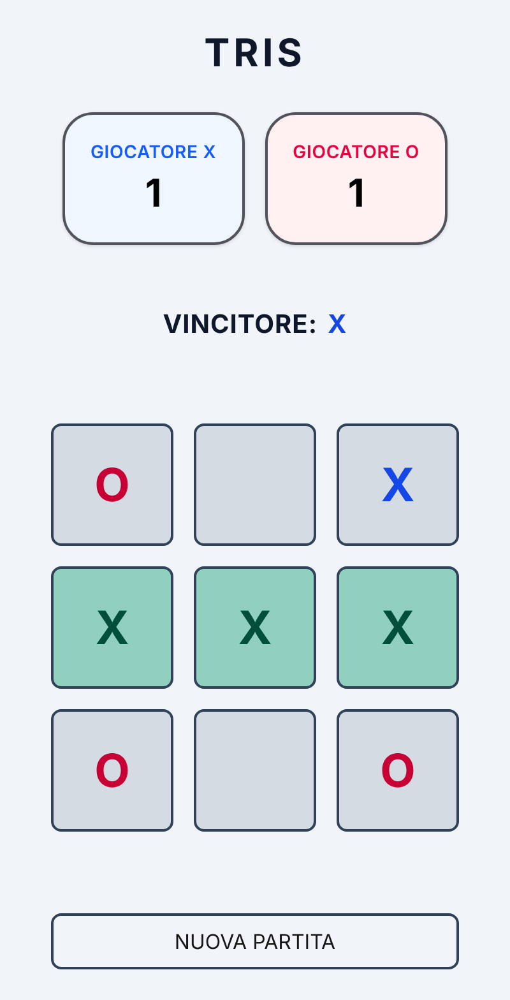

# Tris (Tic-Tac-Toe)

Il gioco del tris per due giocatori sullo stesso dispositivo, realizzato con Next.js e React. Tiene il punteggio delle partite, evidenzia la combinazione vincente e si può giocare anche da tastiera e con un lettore di schermo.

<p align="center">
  
</p>

## Funzionalità

- Partita a due giocatori: X inizia sempre, poi si alterna con O
- Riconoscimento della vittoria e del pareggio, con la combinazione vincente evidenziata
- Punteggio delle vittorie, che resta tra una partita e l'altra
- Pulsante **Nuova partita**, che svuota la griglia senza azzerare il punteggio
- Tema chiaro o scuro, in base alle impostazioni del sistema
- Accessibilità: ogni casella ha un nome per i lettori di schermo, il turno e il risultato vengono annunciati, e si gioca anche con <kbd>Tab</kbd> e <kbd>Invio</kbd>
- Layout che si adatta anche agli schermi piccoli

## Tecnologie

- **Next.js 16** (App Router) e **React 19**
- **TypeScript**
- **Tailwind CSS 4**

## Come avviarlo

Requisiti: [Node.js](https://nodejs.org/) 20.9 o successivo.

```bash
git clone https://github.com/francescoesposito-geeks/tic-tac-toe.git
cd tic-tac-toe
npm install
npm run dev
```

Poi apri [http://localhost:3000](http://localhost:3000).

| Comando         | Cosa fa                         |
| --------------- | ------------------------------- |
| `npm run dev`   | Server di sviluppo              |
| `npm run build` | Build di produzione             |
| `npm run start` | Avvia la build di produzione    |
| `npm run lint`  | Controllo del codice con ESLint |

## Struttura del progetto

```
app/
├── layout.tsx        # struttura HTML, font e metadati della pagina
├── page.tsx          # pagina principale: titolo e griglia di gioco
└── globals.css       # Tailwind e colori del tema chiaro e scuro
components/
├── Board.tsx         # stato della partita: turni, vincitore, pareggio e punteggio
├── Square.tsx        # una casella della griglia
└── LeaderBoard.tsx   # punteggio dei due giocatori
```

## Come funziona

- **Uno stato minimo.** Lo stato contiene solo le 9 caselle e il punteggio. Tutto il resto (di chi è il turno, chi ha vinto, se è pareggio) viene calcolato dalle caselle a ogni render, così non può mai andare fuori sincrono.
- **Il turno si ricava dalla griglia.** X inizia sempre, quindi tocca a X quando le caselle piene sono in numero pari.
- **Il punteggio si aggiorna nel clic.** Viene incrementato nel gestore del clic, nel momento in cui la mossa fa vincere, senza bisogno di un `useEffect`.
- **Un solo Client Component.** `Board` è l'unico componente con stato e interazione (`"use client"`); la pagina resta un Server Component.
